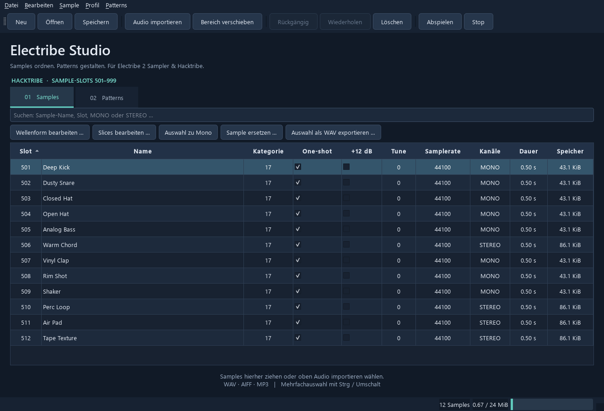
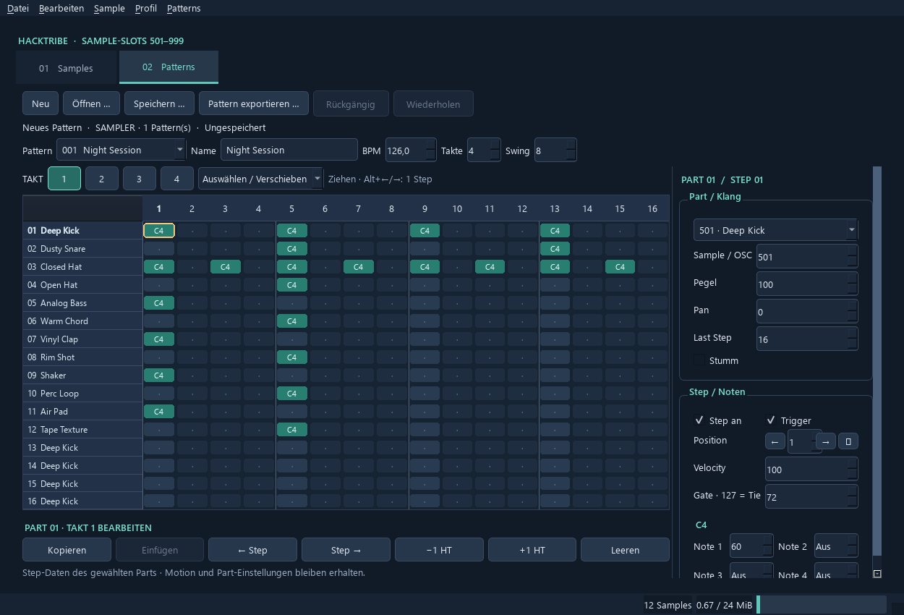

# Electribe Studio

Windows-Editor für **KORG Electribe 2 Sampler und Hacktribe**. Bearbeitet Samples und Patterns über SD-Karten-Dateien.

## Windows 

[Windows-Downloads](https://github.com/johnmof/electribe-studio/releases)

ZIP vollständig entpacken und `ElectribeStudio/ElectribeStudio.exe` starten. Der Ordner `_internal` muss neben der EXE bleiben. Kein Python erforderlich. Windows 10/11 x64.



## Funktionen

- Neu in 0.5.0: **Auswahl verschieben** (Toolbar, Rechtsklick oder **Strg+Umschalt+M**) verschiebt nur die mit Strg/Umschalt markierten Samples lückenlos ab einem Zielslot. Beispiel: 912, 915, 930, 932 → 940, 941, 942, 943. Die Reihenfolge richtet sich nach der Quell-Slotnummer, unabhängig von der aktuellen Sortierung. Namen und Audio bleiben zugeordnet; andere Samples bleiben stehen. Belegte Ziele blockieren den gesamten Vorgang. Geladene Sampler-Patterns werden angepasst. Gemeinsames Undo/Redo.
- Drag & Drop innerhalb der Sample-Liste öffnet dieselbe Vorschau. Auf eine Zeile ziehen, um deren Slot als Ziel vorzuschlagen; auf die freie Fläche ziehen, um ein Ziel einzugeben. Ein belegtes Ziel lässt sich im Dialog ändern. Es wird nichts automatisch überschrieben. **Bereich verschieben** bleibt unter **Bearbeiten** verfügbar und erhält weiterhin die ursprünglichen Abstände.
- Namenseingaben sind an das jeweilige Sample gebunden; Sortierung, Verschieben oder ein Dokumentwechsel dürfen kein anderes Sample umbenennen. Bearbeiten startet per Doppelklick oder F2.
- Fehlerkorrektur 0.4.2: Slotnummern lassen sich wieder direkt in der Tabelle ändern. Quellslot und neuer Slot werden getrennt übergeben; belegte Ziele werden vor der Änderung geprüft. Der Ablauf „905 löschen und erneut belegen“ wurde mit einer bereitgestellten Bank in temporären Kopien getestet. Die Bank selbst wird nicht mitgeliefert.
- Stabilitätsupdate 0.4.1: sichere Tabellenaktualisierung beim Bankwechsel und Bearbeiten, Samplerate nur noch lesbar, Marker nach dem Trimmen ohne gegenseitige Feldänderungen neu laden. Ungültige PCM-Formate werden beim Einlesen abgewiesen. Fehlerprotokolle liegen unter `%LOCALAPPDATA%/ElectribeStudio/logs` (`application.log`, bei nativen Abstürzen nach Möglichkeit `native-crash.log`).
- Neu in 0.4.0: **Sample → Ein-/Ausblenden** bearbeitet die Auswahl mit linearen Fades von 0–100 ms (Vorgabe: je 5 ms). 0 deaktiviert eine Seite. Fades liegen am eingestellten Wiedergabestart/-ende, behalten Stereo-Verhältnis und Marker und lassen sich gemeinsam rückgängig machen. Bei kurzen Samples wird die Dauer begrenzt; Überlappungen werden multipliziert. Loop-Übergänge und einzelne Slice-Grenzen werden nicht automatisch geglättet.
- Neu in 0.4.0: **Sample → Sample-Verwendung anzeigen** listet für die Auswahl Pattern-Nummer, Name, Part und Mute-Status. Zuerst die passende Sampler-Pattern-Datei laden. Auch leere/stumme Parts zählen als Zuordnung. Andere Dateien bleiben unbekannt; Synth-Patterns werden nicht als Sample-Verwendung ausgewertet. Vor Löschen/Ersetzen erscheint bei gefundenen Zuordnungen eine Warnung.
- Neu in 0.3.0: Auswahl auf −1 dBFS normalisieren (Menü **Sample**), gemeinsam pro Stereo-Paar und mit Undo. Stille bleibt unverändert; +12-dB-Geräteeinstellung bleibt separat aktiv. Dies gleicht Spitzenpegel an, nicht die wahrgenommene Lautheit.
- Neu in 0.3.0: **Sample → Identische Audiodaten finden** zeigt doppelte PCM-Daten bei gleicher Kanalzahl und Samplerate. Namen und Wiedergabemarker können abweichen; es wird nichts automatisch gelöscht.
- Sample-Banken `.all` öffnen, erstellen, zusammenführen und speichern.
- WAV, AIFF und MP3 importieren, auch per Drag & Drop.
- MONO/STEREO, Dauer und Speicherbedarf anzeigen; suchen und sortieren.
- Vorhören, umbenennen, ersetzen, duplizieren und WAV exportieren.
- Mehrere Samples zu Mono mischen; beim Import mit wählbaren L/R-Pegeln.
- Wellenform, Start/Loop/Ende, Trim, 64 Slices, One-shot, +12 dB und Tune bearbeiten.
- Ganze Sample-Bereiche mit Vorschau verschieben, einschließlich überlappender Bereiche.
- Geladene Sampler-Pattern-Verweise automatisch mit verschieben.
- Gemeinsames Rückgängig/Wiederholen; Backups beim Überschreiben.

## Bereiche verschieben

Sample-Bank zuerst öffnen, danach unter **Patterns** die dazugehörige Pattern-Datei oder 250er-Bank laden. **Bereich verschieben** wählen und Quellanfang, Quellende sowie neuen Startslot eingeben. Abstände und Lücken bleiben erhalten. Bereits belegte Ziele außerhalb des Quellbereichs blockieren den gesamten Vorgang. Danach **Samples UND Patterns speichern**.

Beispiel für Hacktribe: **601–701 → 501–601**. Überschneidungen werden gleichzeitig verarbeitet, ohne Samples zu verlieren oder Referenzen mehrfach weiterzuschieben.

**Gerätegrenzen:** KORG unterstützt in diesem Editor **19–421 und 501–999**, Hacktribe **501–999**. Die unteren 500 Hacktribe-Plätze sind für Oszillatoren reserviert. Das Beispiel **500–600 → 350–450** trifft reservierte Slots und wird deshalb blockiert. Im KORG-Profil ist beispielsweise **501–571 → 350–420** möglich. Für Hacktribe muss das Ziel ab 501 liegen. Die 1020 Einträge der Dateitabelle bedeuten nicht 1020 nutzbare Geräte-Slots.

Nur geladene Sampler-Patterns werden angepasst. Nicht geöffnete Pattern-Dateien bleiben unverändert. Beim Löschen oder Ersetzen eines Samples werden keine Pattern-Noten gelöscht.

## Patterns



- Neu in 0.7.0: Einzelne aktive Steps im gleichen Part ziehen oder mit **Alt+Links/Rechts** verschieben. Rechts unter **Position** kann ein Ziel-Step (1–64) eingegeben und mit **↵** übernommen werden; die Pfeile daneben bewegen um einen Step. Taktübergreifendes Verschieben folgt automatisch zur Zielposition. Alle bis zu vier Noten des Steps, Gate und Velocity bleiben zusammen. Aktive Ziele werden nicht überschrieben. Tie-Verbindungen werden vorsichtshalber nicht einzeln verschoben. Motion und unbekannte Step-Bytes bleiben an ihren bisherigen Positionen. Undo/Redo wird unterstützt.
- Der Mausmodus **Auswählen / Verschieben** verhindert versehentliches Ausschalten beim Anklicken einer Note. **Steps schalten** stellt das bisherige Klickverhalten wieder her. Leertaste schaltet in beiden Modi. Die Positionskorrektur arbeitet auf gespeicherten Steps; sie rekonstruiert kein ursprüngliches Einspiel-Timing und ist keine automatische Erkennung des gewünschten Rhythmus.
- Neu in 0.6.0: übersichtliches Raster mit Sample-Namen je Part, Notennamen (C4 = MIDI 60), Vierer-Gruppen und eigener Seitenleiste für Part und Step. Taktwechsel über vier direkte Schaltflächen; Pattern- und Sample-Auswahl sind durchsuchbar.
- Im Mausmodus **Steps schalten** schaltet ein Klick den Step an/aus. Im Modus **Auswählen / Verschieben** wählt der Klick nur aus. Pfeiltasten wählen einen Step, Leertaste schaltet ihn. Rechts lassen sich bis zu vier MIDI-Noten, Gate, Velocity und Part-Einstellungen bearbeiten. Die Sample-Auswahl zeigt die Namen aus der geladenen Bank.
- Für den gewählten **Part und Takt**: kopieren/einfügen, einen Step zyklisch links/rechts verschieben, um einen Halbton (HT) transponieren oder Steps ausschalten. Einfügen übernimmt nur die unterstützten Step-Daten; Motion und Part-Einstellungen bleiben am Ziel. Jede Änderung lässt sich rückgängig machen. Transponieren außerhalb MIDI 0–127 wird vollständig blockiert. Takte oberhalb der Pattern-Länge bleiben in der Datei erhalten.
- Einzelpatterns `.e2spat` / `.e2pat` und 250er-Banken `.e2sallpat` / `.e2allpat`.
- Neue Sampler-Patterns, 16 Parts × 64 Steps in vier Takten.
- Vier MIDI-Noten je Step, Velocity, Gate und Trigger.
- Name, Tempo, Swing und Pattern-Länge.
- Sample-/Oszillatornummer, Pegel, Panorama, Mute und Last Step je Part.
- Part-Takt leeren und Einzelpatterns aus einer Bank exportieren.
- Unbearbeitete Bytes, einschließlich Motion- und Effekt-Daten, bleiben erhalten.

Ein Step wird direkt im Raster geschaltet und rechts bearbeitet. Felder werden mit Enter oder beim Verlassen übernommen. MIDI-Noten: 0–127, „Aus“ für leere Notenplätze. Strg+S speichert den aktiven Bereich, Strg+Z macht Änderungen rückgängig.

Synth-Patterns sind editierbar; ihre Klangzuordnung wird nicht automatisch in Sampler-Zuordnungen konvertiert. Automatisches Remapping setzt eine Sampler-Pattern-Datei voraus.

## SD-Karten-Workflow

1. Am Gerät EXPORT ALL SAMPLE und bei Bedarf EXPORT ALL PATTERN ausführen.
2. Dateien auf den PC kopieren; Originale sichern.
3. Sample-Bank und passende Patterns öffnen, Geräteprofil wählen, bearbeiten.
4. Beide Dateien speichern. Überschriebene Dateien erhalten ein `.bak`-Backup.
5. Auf die SD-Karte kopieren und am Gerät importieren.

Sample-Pfade: `KORG/electribe sampler/Sample/e2sSample.all` beziehungsweise `KORG/hacktribe/Sample/e2sSample.all`. Im Zweifel die vom Gerät angelegten Ordner verwenden.

**Profil → Für Hacktribe ab Slot 501 anordnen** nummeriert Samples neu und passt geladene Sampler-Patterns an. Es verändert keine Firmware.

## Prüfung und Grenzen

52 automatisierte Tests wurden unter Windows erfolgreich ausgeführt, einschließlich Datei-Roundtrips, Backups, Mono-Konvertierung, Bereichskollisionen, überlappenden Verschiebungen, Undo/Redo und Pattern-Bearbeitung. Eine öffentliche Hacktribe-Initialbank wurde zusätzlich bytegenau eingelesen und geschrieben. Ein eigener Selbsttest prüft den gebauten Windows-Programmordner.

Version 0.2.0 wurde vom Anwender an seiner KORG getestet und als funktionierend gemeldet. Die Ergänzungen in 0.3.0 und 0.4.0 wurden gezielt automatisiert geprüft; ein eigener Hardwaretest dieser Ergänzungen und ein bestätigter Hacktribe-Hardwaretest stehen noch aus.

Keine direkte USB/MIDI-Verbindung, Pattern-Audiovorschau oder Synthesizer-Emulation. Motion- und Effektparameter bleiben erhalten, haben aber keine eigenen Editoren. Audioimport erzeugt PCM16 mono/stereo; die Samplerate bleibt erhalten. Mehrkanaldateien werden zu Stereo gemischt. KORG-Slice-Metadaten bleiben innerhalb geöffneter `.all`-Banken erhalten; Standard-Audioimport übernimmt nur die unterstützten Cue-/Loop-Marker. Keine Werkssamples oder Firmware enthalten. Warnung ab 24 MiB, Dateiprüfung mit 26.214.396 Bytes Limit. Windows-Paket ohne Codesignatur und ohne Updater.

## Entwickeln und bauen

Python 3.11+ (getestet: 3.13), Windows x64:

```powershell
py -3 -m venv .venv
.\.venv\Scripts\python.exe -m pip install -e '.[dev]'
.\.venv\Scripts\python.exe -m e2sample_manager.app
.\.venv\Scripts\python.exe -m pytest -q
.\.venv\Scripts\ruff.exe check src tests tools
.\.venv\Scripts\python.exe -m PyInstaller --noconfirm packaging/electribe-studio-windows.spec
```

Alternativ `tools/build-windows.ps1`. Ergebnis: `dist/ElectribeStudio/ElectribeStudio.exe`. Selbsttest: `ElectribeStudio.exe --self-test --self-test-report=report.txt`.

## Herkunft und Lizenz

Weiterentwicklung von [Only2000000iqiscool/e2sample-manager](https://github.com/Only2000000iqiscool/e2sample-manager), Ausgangscommit `f8d10508827174530abf6ba3e74488d37b3abb3e`. **GPL-3.0-or-later**, siehe [LICENSE](LICENSE) und [ATTRIBUTION.md](ATTRIBUTION.md). Unabhängig von KORG und Hacktribe.

Formatquellen: [Oe2sSLE](https://github.com/JonathanTaquet/Oe2sSLE), [elecmidi](https://github.com/rafamj/elecmidi/blob/main/elecmidi.h), [Elfer](https://github.com/maks/elfer), [Hacktribe](https://github.com/bangcorrupt/hacktribe/wiki/How-To), [Sample-Dateiformat](https://github.com/untergeekDE/electribe2-docs/blob/main/e2sSample-all-file-format.md).

